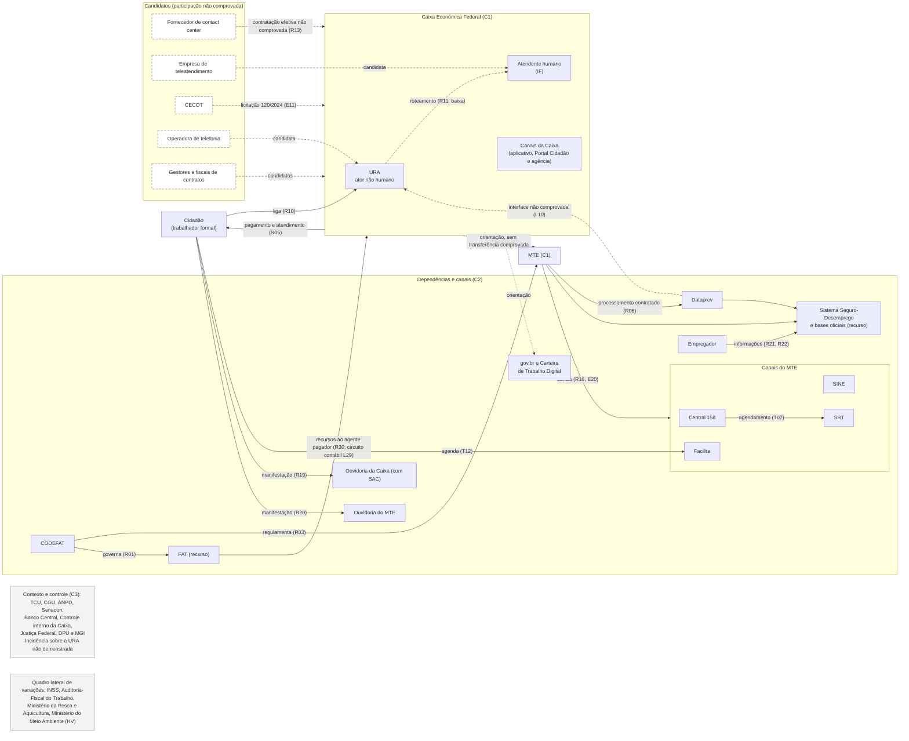

# C — Mapa de atores: Atendimento ao Seguro-Desemprego pela URA da Caixa

**Disciplina:** Transformação Digital — IDP-TD 2026
**Exercício:** 2.1 — Mapa de Atores da Jornada de um Serviço Público
**Data de referência:** 24/11/2026
**Base documental:** `B_relatorio_assistente_v3.md` (identificadores A, R, T, L e E preservados)
**Método:** entrevista adversarial com a skill `grill-me` (registro integral em `C_grill_transcript.md`, exportado com `/export`)

## 1. Delimitação da jornada

- **Gatilho:** o cidadão tem uma dúvida sobre parcela ou status do Seguro-Desemprego e decide ligar para a Caixa (Q2).
- **Encerramento:** um de quatro resultados: informação obtida, encaminhamento a outro canal, demanda não resolvida ou desistência (Q2).
- **Núcleo do mapa:** trabalhador formal. As demais modalidades aparecem no quadro lateral de variações (seção 5) (Q3).
- **Ramificações, fora do fluxo principal:** ouvidoria, recurso e Justiça (Q2, Q12).
- **Classificação das evidências:** FC (fato confirmado), IF (inferência fundamentada), HV (hipótese a verificar), LI (lacuna de informação), NC (não comprovado, usado nas matrizes) (Q1).

### Critérios do mapa

- **Ator:** quem decide, executa ou responde por algo. A URA entra como ator não humano ("sistema de atendimento"), com R apenas pelo atendimento automatizado genérico e A sempre da Caixa (Q4, Q7).
- **Recurso ou canal:** aparece no diagrama, mas não recebe papel na RACI. Fica ancorado ao seu dono (FAT ao CODEFAT, Sistema Seguro-Desemprego e bases oficiais ao MTE e à Dataprev, Facilita ao MTE) (Q4, Q17).
- **C1:** participa do atendimento ou é responsável final (A) por uma das duas colunas de demanda (Q13).
- **C2:** dependências que produzem informação, tecnologia, regra ou canal alternativo (Q9, Q13).
- **C3:** contexto e controle, ou participação eventual (Q12).
- **Candidato (tracejado):** participação plausível e não comprovada na URA do Seguro-Desemprego (Q6, Q22).
- **Regra de saída:** o ator sai do mapa se uma fonte refutar sua participação. Fica tracejado se só faltar evidência. Passa a cheio apenas com documento que comprove a participação na URA do Seguro-Desemprego. Contrato genérico da Caixa não serve (o Contrato 04/2023 trata do Abono Salarial) (Q22).

## 2. Diagrama de atores

Decisões aplicadas: C1, C2 e candidatos (Q6, Q13); Caixa e MTE como blocos únicos, com o atendente humano como papel próprio dentro da Caixa (Q5, Q8); canais agrupados por dono, sem o MGI como ator (Q18); ouvidorias como ramificação e faixa única de contexto e controle (Q12); empregador como ator em C2 (Q17, Q19); FAT ancorado ao CODEFAT, com recursos ao agente pagador (correção final).

### Legenda (Q15)

| Símbolo | Significado |
| --- | --- |
| Nó cheio | Ator documentado (FC) ou inferência fundamentada (selo "IF") |
| Nó tracejado | Candidato (HV ou LI) |
| Seta sólida | Relação documentada (FC) |
| Seta tracejada | Relação de confiança baixa ou não comprovada |
| Seta pontilhada | Orientação para outro canal, sem transferência comprovada |

Só T07 (Central 158 para unidade do MTE) e T12 (Cidadão para Facilita) aparecem como transferências documentadas. Os demais encaminhamentos são orientação ou "não comprovado" (Q10).

## 3. Tabela de atores

A tabela lista todos os atores de C1, C2 e C3, inclusive os candidatos tracejados, nas colunas do exercício (Q16). "Categoria" diz o tipo de ator e "Camada" a proximidade com a ligação (Q21). "Antes da ligação" e "Acionado por" indicam que não há ponto único de entrada na jornada. Nenhum ponto foi inventado (Q20).

| Ator | Categoria | Papel | Entra na jornada | Sai da jornada | Camada | Evidência |
| --- | --- | --- | --- | --- | --- | --- |
| Cidadão | A — Demandante | Inicia a demanda e usa os canais disponíveis | Necessidade de informação sobre parcela ou status | Informação obtida, encaminhamento, demanda não resolvida ou desistência | C1 | FC — E04, E05 |
| Caixa | G — Financiamento e execução financeira (também canal de atendimento) | Dona do canal telefônico; agente pagador contratado; A na coluna de pagamento | Recebimento da chamada | Informação prestada, pagamento realizado ou orientação a outro canal | C1 | FC — E04, E09 |
| URA | B — Atendimento automatizado | Ator não humano. R pelo atendimento automatizado genérico; A sempre da Caixa (Q4, Q7) | Chamada encaminhada ao atendimento automatizado | Resposta automatizada, roteamento ou encerramento (funcionalidades específicas não comprovadas) | C1 | FC quanto à consulta telefônica (E04); NC quanto a menus e funções (L01 a L04) |
| Atendente humano | C — Atendimento humano | Papel funcional dentro da Caixa; trata a demanda quando a URA não resolve (Q5, Q8) | Chamada encaminhada para atendimento humano (roteamento não comprovado) | Resposta, registro ou encaminhamento (escalonamento não comprovado) | C1 | IF — E03; vínculo empregado ou terceirizado em aberto (L06) |
| MTE | F — Normatização e governança | Administra o benefício; A na coluna de habilitação (status, habilitação, indeferimento, recurso) | Requerimento, recurso ou necessidade de administração do benefício | Resultado de processamento, decisão administrativa ou informação para a execução financeira | C1 | FC — E01, E02, E24, E30 |
| Dataprev | E — Sistemas e dados | Processamento tecnológico da habilitação, a serviço do MTE (Q13) | Antes da ligação | Não sai (permanece como condição) | C2 | FC quanto ao processamento (E07, E08); interface com a URA NC (L10) |
| Sistema Seguro-Desemprego e bases oficiais | E — Sistemas e dados (recurso) | Aferição automatizada dos requisitos (eSocial, CNIS, CAGED, Empregador Web). Sem papel na RACI | Antes da ligação | Não sai | C2 | FC quanto à previsão normativa (E02, art. 4º) |
| CODEFAT | F — Normatização e governança | Define as regras de habilitação e delibera sobre o programa (Q9) | Antes da ligação | Não sai | C2 | FC — E01, E02, E29 |
| FAT | G — Financiamento (recurso) | Fonte de financiamento do programa, ancorada ao CODEFAT. Não é agente decisório. Disponibiliza recursos ao agente pagador (R30; circuito contábil L29) (Q4, correção final) | Antes da ligação | Não sai | C2 | FC — E01 |
| Empregador | J — Transversal | Origem das informações trabalhistas que definem a habilitação. O nexo com as dúvidas que geram a ligação é IF (Q17, Q19) | Antes da ligação | Não sai | C2 | FC pela relação com eSocial e Empregador Web (R21, R22; E18, E19); nexo com a ligação: IF |
| Central 158 | C — Atendimento humano (canal do MTE) | Orientação e agendamento de serviços do MTE | Cidadão procura o MTE (por conta própria) | Informação prestada ou agendamento confirmado | C2 | FC — E20 |
| Facilita | J — Transversal (canal digital do MTE) | Agendamento de atendimento presencial | Cidadão busca agendar atendimento | Agendamento confirmado | C2 | FC — E20 |
| SINE | C — Atendimento humano (canal do MTE) | Rede descentralizada de atendimento ao trabalhador | Agendamento ou procura presencial | Atendimento presencial concluído | C2 | FC — E05; R16 |
| SRT | C — Atendimento humano (canal do MTE) | Atendimento presencial vinculado ao MTE | Agendamento ou procura presencial | Atendimento presencial concluído | C2 | FC — E05; R16, T07 |
| gov.br e Carteira de Trabalho Digital | J — Transversal (canal digital) | Canal digital de consulta e requerimento. O MGI não é ator aqui; fica na faixa de contexto (Q18) | Cidadão orientado ou decide usar o canal | Consulta ou requerimento realizado | C2 | FC — E05 |
| Canais da Caixa (aplicativo, Portal Cidadão e agência) | J — Transversal (canais da Caixa) | Alternativas de consulta e atendimento presencial (Q18) | Cidadão orientado ou decide usar o canal | Consulta ou atendimento concluído | C2 | IF — E03 |
| Ouvidoria da Caixa (com SAC) | I — Ouvidoria | Recebe manifestações sobre o atendimento da Caixa (Q12) | Acionada por reclamação do cidadão (J10) | Manifestação tratada (procedimento específico não localizado) | C2 | R19, confiança média — E03 |
| Ouvidoria do MTE | I — Ouvidoria | Recebe manifestações sobre o benefício e o atendimento ministerial (Q12) | Acionada por reclamação do cidadão (J10) | Manifestação tratada | C2 | FC — E13 (R20) |
| Fornecedor de contact center | E — Sistemas e fornecedores (candidato) | Possível provedor da plataforma de atendimento (Q6) | Contratação, se existente | Não determinado | Candidato | HV; licitação 120/2024 comprovada, contratação vigente LI (E11; L07) |
| Empresa de teleatendimento | E — Sistemas e fornecedores (candidato) | Possível empregadora dos atendentes (Q6) | Contratação, se existente | Não determinado | Candidato | HV (L06) |
| CECOT | E — Sistemas e fornecedores (candidato) | Unidade da Caixa que conduziu a licitação 120/2024. Gestão da URA específica não comprovada (rodada final) | Licitação (antes da ligação) | Não determinado | Candidato | FC quanto à licitação (E11); HV quanto à URA |
| Operadora de telefonia | E — Sistemas e fornecedores (candidato) | Viabilizaria a comunicação telefônica do canal (Q22, rodada final) | Chamada do cidadão (se existente) | Fim da chamada | Candidato | HV (A25); nenhuma fonte refuta; sem ID de lacuna próprio no v3, relacionada a L07 |
| Gestores e fiscais de contratos | D — Gestão e supervisão (candidato) | Acompanhariam a prestação contratada (Q22, rodada final) | Contratação, se existente | Não determinado | Candidato | HV (A27); nenhuma fonte refuta; sem ID de lacuna próprio no v3, relacionada a L05 e L08 |
| TCU | H — Controle externo | Controle externo da Licitação 120/2024 e da gestão do benefício | Acionado por fiscalização ou representação | Acórdão ou deliberação | C3 | FC — E08, E11 (R17, R18); incidência sobre a URA não demonstrada |
| CGU | H — Controle interno federal | Controle interno federal | Acionada por auditoria ou denúncia | Relatório ou recomendação | C3 | Competência geral; incidência sobre a URA não demonstrada |
| ANPD | H — Controle | Supervisão de dados pessoais | Acionada por questão de tratamento de dados pessoais | Decisão ou orientação | C3 | FC — E26 (art. 55-J; R31); incidência sobre a URA não demonstrada |
| Senacon | H — Controle | Regulação consumerista, quando aplicável | Acionada se o atendimento for relação de consumo | Fiscalização ou sanção | C3 | E27 (art. 23; R32); aplicabilidade condicionada (D5, L23) |
| Banco Central | H — Controle | Supervisão financeira, quando aplicável | Acionado se a demanda tiver natureza financeira | Supervisão ou decisão | C3 | HV; condicionado (A43) |
| Controle interno da Caixa | H — Controle | Supervisão institucional da Caixa | Acionado por auditoria interna | Relatório ou recomendação | C3 | HV (A49) |
| Justiça Federal | H — Controle (contestação judicial) | Eventual contestação judicial | Acionada por ação do cidadão | Sentença ou acordo | C3 | Participação eventual (A44) |
| DPU | H — Controle (assistência jurídica) | Eventual assistência jurídica ao cidadão | Acionada por pedido do cidadão | Atuação concluída | C3 | Participação eventual (A45) |
| MGI | F — Normatização e governança (contexto) | Governança da identidade digital gov.br. Participação na autenticação telefônica da Caixa não comprovada (Q12, Q18) | Acionado se o cidadão usar serviço digital com conta gov.br | Não sai | C3 | FC quanto à competência normativa (E25; R25); participação na URA NC |
| INSS | F — Normatização e governança (variação) | Competência residual na transição do Seguro-Defeso (pescador artesanal) | Pedidos anteriores à transição | Fim do tratamento residual | C3 | FC — E28 a E30 (R23) |
| Auditoria-Fiscal do Trabalho | F — Normatização e governança (variação) | Origem administrativa do benefício do trabalhador resgatado | Resgate do trabalhador | Encaminhamento ao MTE | C3 | FC — E01 (R24) |
| Ministério da Pesca e Aquicultura | F — Normatização e governança (variação) | Disponibiliza ao MTE as informações do Registro Geral da Atividade Pesqueira | Antes do requerimento do pescador | Não sai | C3 | FC — E24, art. 37 (R27, T13); participação na ligação NC |
| Ministério do Meio Ambiente | F — Normatização e governança (variação, candidato) | Regulamentação ambiental dos períodos de defeso (rodada final) | Não determinado | Não determinado | C3, candidato | HV (A47; R28) |

## 4. Matrizes RACI

Duas matrizes por tipo de demanda, com as etapas da jornada nas linhas e um único A por linha (Q11, Q16). Só entram células com evidência (FC ou IF); o restante fica NC (Q1, Q7).

**Convenções:** R executa a atividade. A responde pelo resultado (um único A por linha). C é consultado ou é fonte da informação. I é informado. **NC** significa não comprovado (a lacuna é indicada). **—** significa que o ator não se aplica à etapa. O J01 é o gatilho e não tem linha. Recursos e canais sem papel (FAT, Sistema Seguro-Desemprego e bases oficiais, Facilita, SINE, SRT e atores tracejados) não aparecem nas colunas.

### 4.1. Matriz de pagamento (parcela, data e recebimento) — A = Caixa (Q11)

| Etapa | Cidadão | URA | Atendente humano | Caixa | MTE | Dataprev | CODEFAT | Central 158 | Ouvidorias |
| --- | --- | --- | --- | --- | --- | --- | --- | --- | --- |
| J02 Ligar para a Caixa | R | R (atendimento automatizado genérico, E04) | — | A | — | — | — | — | — |
| J03 Navegar pelos menus | R | NC (L01) | — | A | — | — | — | — | — |
| J04 Identificar-se | R | NC (L03) | — | A | — | NC (L10) | — | — | — |
| J05 Consultar parcelas | R | NC (L04) | NC (L09) | A | C (IF; R08, R09, E02) | NC (L10) | — | — | — |
| J06 Obter resposta automatizada | I | NC (L02) | — | A | — | — | — | — | — |
| J07 Receber atendimento humano | I | NC (R11, T02) | NC (L06, L09) | A | — | — | — | — | — |
| J08 Buscar outro canal | R | — | — | A (IF; orientação, T05) | — | — | — | — | — |
| J09 Procurar atendimento presencial | R | — | — | A (agência, E03) | — | — | — | — | — |
| J10 Reclamar ou contestar | R | — | — | A | — | — | — | — | R (Ouvidoria da Caixa, R19) |

### 4.2. Matriz de habilitação (status do requerimento, habilitação, indeferimento e recurso) — A = MTE (Q11)

As linhas J02 a J07 desta matriz são condicionais: não está comprovado que a URA receba demandas de habilitação ou recurso (L02) (Q14). A coluna Caixa, nessas linhas, também é NC: não se atribui R à Caixa sem fonte (rodada final).

| Etapa | Cidadão | URA | Atendente humano | Caixa | MTE | Dataprev | CODEFAT | Central 158 | Ouvidorias |
| --- | --- | --- | --- | --- | --- | --- | --- | --- | --- |
| J02 Ligar para a Caixa | R | NC (L02) | — | NC (L02) | A | — | — | — | — |
| J03 Navegar pelos menus | R | NC (L01, L02) | — | NC (L02) | A | — | — | — | — |
| J04 Identificar-se | R | NC (L03) | — | NC (L02) | A | NC (L10) | — | — | — |
| J05 Consultar status do requerimento | R | NC (L02) | NC (L09) | NC (L02) | A | C (processamento, E02 art. 4º, E07) | C (define critérios, E02) | — | — |
| J06 Obter resposta automatizada | I | NC (L02) | — | NC (L02) | A | — | — | — | — |
| J07 Receber atendimento humano | I | NC (T02) | NC (L06, L09) | NC (L02) | A | — | — | — | — |
| J08 Buscar outro canal | R | — | — | NC (T06) | A | — | — | R (agendamento, E20) | — |
| J09 Procurar atendimento presencial | R | — | — | — | A (SRT e SINE executam, E05, R16) | — | — | R (T07, E20) | — |
| J10 Reclamar ou contestar (inclui recurso) | R | — | — | — | A (recurso, E02 art. 4º §2º, E06, T14) | — | — | — | R (Ouvidoria do MTE, E13) |

## 5. Quadro lateral de variações por modalidade

As variações mudam quem habilita o benefício, mas não mudam a ligação para a Caixa. Os públicos específicos são variações do cidadão, não atores separados (Q3).

| Modalidade | Dependências diferenciadas | Evidência |
| --- | --- | --- |
| Empregado doméstico | Empregador doméstico, eSocial e MTE | Relatório v3, seção 4.4 |
| Pescador artesanal | MTE (habilitação), Ministério da Pesca e Aquicultura (RGP), INSS na transição, Ministério do Meio Ambiente (HV) | E24, E28 a E30 |
| Trabalhador resgatado | Auditoria-Fiscal do Trabalho e MTE | E01 |
| Representante legal | Atua em nome do beneficiário; participação eventual (A50) (rodada final) | L24 |

## 6. Nota: desencontro entre quem atende e quem decide (IF) (Q11, Q14)

O cidadão liga para a Caixa, mas a responsabilidade final depende do tipo de demanda:

- **Parcela, data e recebimento:** responde a Caixa, como agente pagador (E04, E09).
- **Status do requerimento, habilitação e recurso:** responde o MTE (E01, E02, E24).

A ligação para a URA pode misturar os dois tipos, e o cidadão não tem como saber qual instituição decide o que procura. Este é o principal achado do mapa.

**Classificação: IF.** Baseia-se na divisão de competências. Não está comprovado que a URA receba demandas de habilitação ou recurso (L02), nem que exista transferência efetiva entre Caixa e MTE (T06, R15). A seta Caixa para MTE é só orientação para outro canal (Q10).

## 7. Limites do mapa

### 7.1. Lacunas de alta prioridade

| ID | Lacuna | Efeito no mapa |
| --- | --- | --- |
| L01 a L04 | Menus, funcionalidades, identificação do cidadão e consulta de parcelas na URA | URA com R só pelo atendimento genérico; ações específicas NC |
| L05 | Unidade gestora da central | Gestor da central fora do mapa |
| L06 | Modelo próprio, terceirizado ou híbrido | Vínculo do atendente em aberto; empresa de teleatendimento tracejada |
| L07 | Fornecedor tecnológico atual | Fornecedor de contact center tracejado e genérico |
| L08 e L21 | Remuneração específica da URA do Seguro-Desemprego | Nenhum valor atribuído; o Contrato 04/2023 trata do Abono Salarial |
| L09 | Sistemas consultados pelos atendentes | Células do atendente NC |
| L10 | Integração Caixa e Dataprev | Seta Dataprev para URA tracejada |
| L11 | Transferência direta ao MTE | Seta Caixa para MTE é só orientação |
| L17 | Contrato atualizado MTE–Dataprev | R06 com confiança média |
| L29 | Circuito contábil de recursos ao agente pagador | Seta FAT para Caixa (R30, confiança média) representa só o fluxo funcional |
| Sem ID próprio no v3 | Operadora de telefonia (A25) e gestores e fiscais de contratos (A27) | Tracejados, por falta de refutação (Q22, rodada final) |

### 7.2. Elementos do inventário fora do mapa

| Elemento | Tratamento | Motivo |
| --- | --- | --- |
| Gestor da central, Supervisor, Equipe de qualidade (A06 a A08) | Fora | Sem fonte (L05, L15) (Q5) |
| Fala.BR (A32) | Agrupado com as ouvidorias | Recurso das ouvidorias (Q4) |
| Rede lotérica e banco do beneficiário (A10, A34) | Só em nota | Variações do recebimento, não da informação (Q18) |
| Gestores do eSocial (A39) | Fora | Governança não detalhada (L25) |
| Trabalhador formal, empregado doméstico, pescador artesanal e trabalhador resgatado (A51 a A54) | Variações do Cidadão | Não são atores separados (Q3) |

### 7.3. Limites gerais

- O mapa não comprova o funcionamento operacional da URA. Sustenta competências, contratos e normas, não a operação concreta.
- Muitas fontes (marcadas ANT no relatório v3) foram herdadas de versões anteriores e não foram integralmente revalidadas.
- A aplicabilidade do Decreto 13.135/2026 (SAC) ao atendimento da Caixa como agente pagador não foi demonstrada (D5, L23).
- Os horários de atendimento não foram confirmados (L19) e não constam do mapa.
- A seleção em camadas é uma proposta metodológica validada na entrevista adversarial, não uma classificação oficial.
- Nenhuma célula das matrizes RACI converte hipótese em responsabilidade. Onde falta fonte, a célula diz NC.

## 8. Decisões da entrevista

Uma linha por decisão. A coluna "Correção do responsável pelo mapa" registra o que foi alterado em relação à proposta inicial do entrevistador, quando houve alteração. O registro integral está em `C_grill_transcript.md`.

| Questão | Decisão tomada | Correção do responsável pelo mapa |
| --- | --- | --- |
| Q1 — Natureza e formato | Diagrama como peça principal e RACI complementar. Só células com evidência (FC ou IF); hipótese e lacuna ficam "não comprovado" | Reforço: suposição não vira responsabilidade |
| Q2 — Evento inicial e final | Início: dúvida sobre parcela ou status que leva à ligação. Fim: informação obtida, encaminhamento, demanda não resolvida ou desistência. Ouvidoria, recurso e Justiça são ramificações | Nenhuma |
| Q3 — Escopo de modalidades | Núcleo no trabalhador formal. Demais modalidades em quadro lateral. A51 a A54 são variações do cidadão | Nenhuma |
| Q4 — O que conta como ator | Critério de dois níveis: ator e recurso ou canal. FAT, sistemas internos, Facilita e Fala.BR são recursos ligados ao seu dono | URA entra como ator não humano ("sistema de atendimento"), com R e A sempre da Caixa |
| Q5 — Granularidade de Caixa e MTE | Caixa e MTE como blocos únicos. Central 158, SINE e SRT como canais do MTE. Gestor, supervisor e qualidade fora, por falta de fonte | Atendente humano entra como papel próprio dentro da Caixa |
| Q6 — Atores não comprovados | Candidatos tracejados, com legenda "participação não comprovada" e lacuna referenciada, sem R nem A. Fornecedor genérico, sem nome de empresa | Nenhuma |
| Q7 — R da URA | R apenas pelo atendimento automatizado genérico (E04). Classificar, informar parcelas e rotear ficam NC (L01 a L04) | O responsável reconheceu a inconsistência da exceção da Q4 com a regra da Q1 |
| Q8 — Status do atendente humano | Nó cheio classificado IF. Seta URA→Atendente tracejada. Sem horário e sem R para ações específicas. Vínculo em aberto (L06) | Nenhuma |
| Q9 — Núcleo C1 | Proposta: Cidadão, Caixa, MTE, Dataprev e CODEFAT | Discordância: CODEFAT e FAT vão para C2; C1 só com quem atua na jornada da ligação |
| Q10 — Caixa→MTE | Orientação para outro canal, seta pontilhada. Só T07 e T12 são transferências documentadas | Nenhuma |
| Q11 — Quem responde pela resolução | Duas colunas de demanda: pagamento (A = Caixa) e habilitação (A = MTE). O desencontro vira nota e é o principal achado | Nenhuma |
| Q12 — Controle e ouvidoria | Só as ouvidorias da Caixa e do MTE têm nó e seta. TCU, CGU, ANPD, Senacon, Banco Central, controle interno da Caixa, Justiça Federal e DPU ficam numa faixa de contexto | Nenhuma |
| Q13 — Critério único para C1 | C1 = participa do atendimento ou é A de uma coluna. Cidadão, Caixa e MTE. Dataprev vai para C2, ancorada ao MTE | O responsável reconheceu a incoerência da Q9 (CODEFAT saiu e a Dataprev ficou pelo mesmo motivo) |
| Q14 — Estatuto do achado | A nota do desencontro é IF, baseada em competências. Recepção de demandas de habilitação pela URA não comprovada (L02) | O responsável reconheceu a formulação exagerada |
| Q15 — Legenda visual | Nó cheio, nó tracejado, seta sólida, tracejada e pontilhada, no diagrama e na RACI | Nenhuma |
| Q16 — Estrutura da RACI | Duas matrizes, linhas = etapas J02 a J10, um único A por linha, "não comprovado" visível | Acréscimo: tabela de atores com as colunas Ator, Categoria, Papel, Entra e Sai, para todos os atores de C1, C2 e C3, inclusive candidatos |
| Q17 — Empregador e bases de dados | Bases agrupadas em um recurso ("Sistema Seguro-Desemprego e bases oficiais"), ancorado ao MTE e à Dataprev | Concordância em parte: o empregador continua como ator em C2, sem RACI, e não só como nota |
| Q18 — Canais de destino | Agrupados por dono (MTE, Caixa, gov.br). MGI na faixa de contexto. Rede lotérica e banco do beneficiário só em nota | Nenhuma |
| Q19 — Empregador em C2 | Ator documentado pela relação com eSocial e Empregador Web. O nexo com a ligação é IF | Nenhuma |
| Q20 — Entra e sai para atores fora da ligação | "Antes da ligação" ou "Acionado por", sem inventar ponto de entrada | Nenhuma |
| Q21 — Coluna Categoria | Categoria (A a J do meta-prompt) e Camada em colunas separadas | Nenhuma |
| Q22 — Regra de saída | Sai se uma fonte refutar. Fica tracejado se só faltar evidência. Sobe para cheio só com documento específico da URA do Seguro-Desemprego | Nenhuma |
| Q23 — Entrega e formato | Diagrama Mermaid, tabela de atores, duas matrizes RACI, nota do desencontro e limites do mapa. Sem gerar a transcrição | O arquivo se chama exatamente `C_mapa_atores.md`. `C_grill_transcript.md` vem do `/export`, com a conversa integral |
| Rodada final — CECOT | Candidato tracejado, ligado à Caixa pela licitação 120/2024 (E11) | Nenhuma |
| Rodada final — Ministério do Meio Ambiente | Candidato (HV) no quadro de variações | Nenhuma |
| Rodada final — Representante legal | Variação do cidadão (coerente com a Q3) | Nenhuma |
| Rodada final — Operadora de telefonia e gestores e fiscais de contratos | Entram tracejados, com a lacuna correspondente | Discordância da exclusão proposta: pela regra da Q22, ator sem evidência permanece tracejado até que uma fonte o refute |
| Rodada final — Matriz de habilitação | Caixa como NC nas linhas J02 a J07; sem R sem fonte | Nenhuma |
| Correção final — Fluxo do FAT | Seta do FAT para a Caixa, "recursos ao agente pagador (R30; circuito contábil L29)". O FAT permanece ancorado ao CODEFAT | O responsável corrigiu a seta FAT→MTE, que repetia o erro N05 da segunda auditoria |
